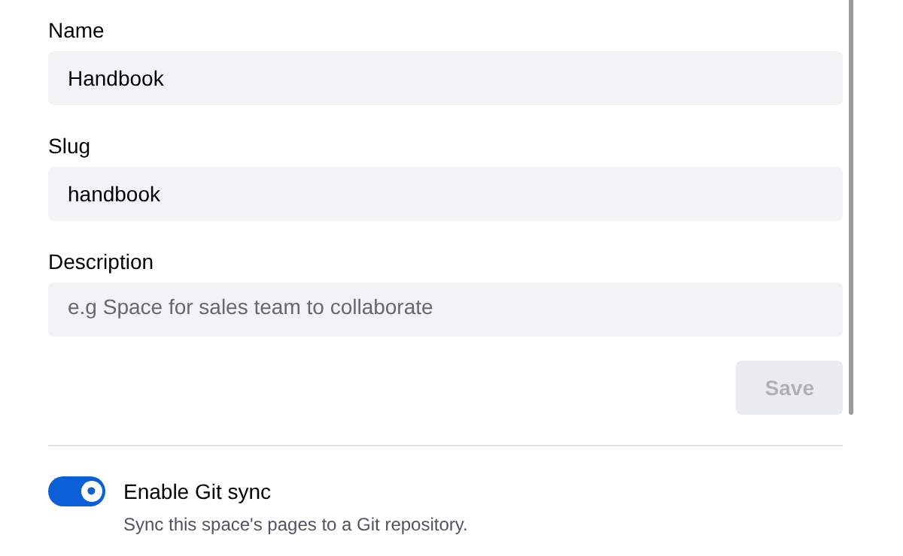
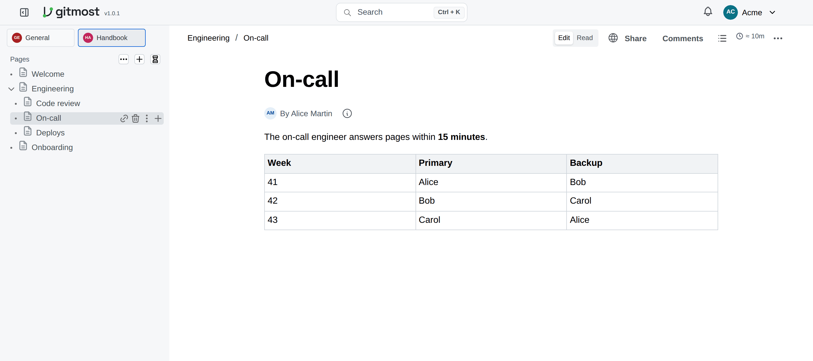
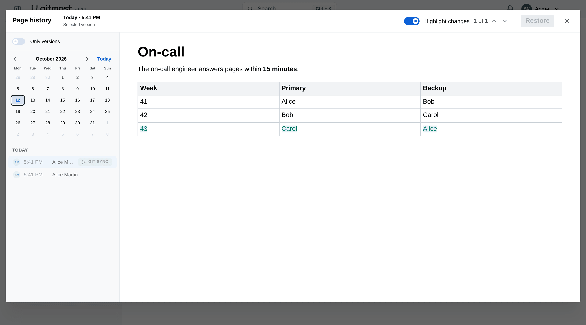

# Git sync

[Русская версия](git-sync.ru.md)

Git sync mirrors a space into a git repository of Markdown files and keeps the two in step in both
directions. A page edited in the wiki shows up in git as a commit; a commit pushed to the
repository shows up in the wiki as page edits. People can keep editing the same pages in the
browser while this happens: writes from git go through the real-time collaboration layer, so they
never overwrite someone who is typing.

Each space gets its own repository, served by Gitmost itself over HTTP. You can open a clone in
any editor, in Obsidian, or script against it.

## Turning it on

Git sync is off by default. The server needs two settings:

```env
GIT_SYNC_ENABLED=true
# id of the Gitmost user that changes coming from git are attributed to
GIT_SYNC_SERVICE_USER_ID=<user id>
```

The server refuses to start with sync enabled and no service user. Also point `GIT_SYNC_DATA_DIR`
at a persistent volume: the repositories live there (default `<DATA_DIR or ./data>/git-sync`,
which in Docker is outside the `/app/data/storage` volume).

Then a space admin opens **Space settings → Settings** and turns on **Enable Git sync**:



The first sync runs within seconds and exports every page of the space. The space's slug (here
`handbook`) is the repository name.

A space that contains pages with page-level access restrictions cannot be synced: a clone would
show every page to every member, and a push would bypass the per-page check. Enabling sync on such
a space fails with an error that says so.

## Cloning and pushing

The repository is at `/git/<space-slug>.git` on your Gitmost host. Log in with your Gitmost email
and password (HTTP Basic auth; API keys are not accepted, and an SSO account needs a local
password):

```console
$ git clone https://wiki.example.com/git/handbook.git
$ cd handbook
$ find . -name '*.md' | sort
./Engineering/Code review.md
./Engineering/Engineering.md
./Engineering/On-call.md
./Onboarding.md
./Welcome.md
```

| Your role in the space | What you can do |
| --- | --- |
| Can view | clone and fetch |
| Can edit, Full access | clone, fetch and push |
| Not a member | nothing: the repository answers 404, like a space that does not exist |

## What is in the repository

Every page is one Markdown file named after its title. A page with subpages becomes a folder with
the same name, and the page itself is the folder note inside it: `Engineering` above is
`Engineering/Engineering.md`, and its subpages sit next to it.

A file holds the page's id in the front matter and the page body in Markdown:

```markdown
---
gitmost_id: 01a1312f-d619-7cdd-b37f-8afd50426105
---

The on-call engineer answers pages within **15 minutes**.

| Week | Primary | Backup |
| --- | --- | --- |
| 41 | Alice | Bob |
| 42 | Bob | Carol |
```

The `gitmost_id` is what ties a file to its page, so a page keeps its identity through renames and
moves. Do not edit it; for a new page, leave it out and Gitmost adds it.

Some details of the layout:

- Characters that are not allowed in file names (`/ \ < > : " | ? *`) become `-`; names are cut at
  120 characters.
- Two sibling pages with the same title: the second one gets its short id appended, e.g.
  `Notes ~a1b2c3d4e5.md`.
- Images and attachments stay in Gitmost. The Markdown links to them (`/api/files/…`); the files
  themselves are not in the repository.
- Links to other pages are ordinary Markdown links to the page's address in the wiki.
- Commits made by Gitmost are authored by `Docmost Sync <docmost-sync@local>` and titled by what
  changed in the wiki: `docmost: edit N page(s)`, `docmost: delete N page(s)` or both.

## Changing pages from git

Commit and push as usual. Gitmost applies the commit within seconds:

```console
$ echo "| 43 | Carol | Alice |" >> Engineering/On-call.md
$ printf '# Deploys\n\nWe deploy from `main` every weekday at 11:00.\n' > Engineering/Deploys.md
$ git add -A && git commit -m "On-call: week 43; add Deploys"
$ git push
```

The table gets its new row, and `Deploys` appears as a new subpage of `Engineering`:



What each change in git does in the wiki:

| In git | In the wiki |
| --- | --- |
| Edit a file | The page is updated (merged with wiki edits, see below) |
| Add a `.md` file without `gitmost_id` | A new page; its title is the file name, its parent the folder note of the folder it is in (or the space root if there is none) |
| Rename a file | The page is renamed |
| Move a file to another folder | The page moves under that folder's page |
| Delete a file | The page goes to the trash, **with all its subpages** |
| Copy a file (two files with one `gitmost_id`) | The copy becomes a new page; the original stays the page |
| Other files (images, `.obsidian/`, non-`.md`) | Ignored, but kept in the repository |

After the push, Gitmost commits back what it changed, for example the `gitmost_id` of a new page.
Run `git pull` before you push again:

```console
$ git pull
$ git log --oneline
ac4aef6 docmost: edit 1 page(s)
5573f53 On-call: week 43; add Deploys
d7adef3 docmost: edit 5 page(s)
b6f9a6b init vault
$ head -3 Engineering/Deploys.md
---
gitmost_id: 01a13134-5dc3-79fc-bf35-c49cecc4c876
---
```

A push based on an older `main` is refused as non-fast-forward, as with any shared repository:
pull, merge locally and push again.

## Changes made in the wiki

Every edit, new page, rename, move or deletion in the wiki becomes a commit on `main`, usually
within half a minute: the editor saves a page about 10 seconds after typing stops, and every space
is checked again at least every 15 seconds:

```console
$ git pull
$ git log -1 --format='%an <%ae>%n%s'
Docmost Sync <docmost-sync@local>
docmost: edit 1 page(s)
$ git diff HEAD~1 -- Welcome.md
@@ -8,3 +8,5 @@
 - [Engineering](#) practices
 - [Onboarding](#) checklist
+
+Questions? Ask in the #handbook channel.
```

## When both sides change the same page

Gitmost merges the page block by block (a block is a paragraph, a heading, a list, a table, …).
Blocks changed on only one side keep that side's version. Where git and the wiki changed the same
block, **the version from git wins**, and the page's previous state is kept in page history, so
nothing is lost. There are no conflict markers to resolve.

Versions written by git sync carry a **Git sync** badge in page history:



The version is attributed to the service user from `GIT_SYNC_SERVICE_USER_ID`, not to the author of
the git commit.

## Limits

- A push may add or change at most 10,000 files, 16 MiB per file, 2 MiB per `.md` file and 256 MiB
  in total; a larger push is refused with the reason. While a space is busy with a sync, or too many
  git requests run at once, the server answers 503 and git can simply retry.
- Things Markdown cannot carry stay in the wiki only: comments (the file keeps only their
  anchors), page icons, the order of sibling pages, indentation, callout icons, table column widths
  and cell colours. Editing such a block from git keeps them in the wiki.
- Your own front matter keys (e.g. Obsidian properties) are dropped; only `gitmost_id` is kept.
  `[[wikilinks]]` are not converted.
- A page with content the Markdown converter cannot represent is not exported; it is listed in the
  space's sync status (see below) and retried every cycle.
- Mass deletion from the wiki side is held back: if an export would delete more than half of the
  files (out of at least 4) or leave the space with no pages, it deletes no files and logs why.
  Deletions pushed from git are applied as they are.
- One server instance only: the sync lock is not shared between replicas.

## For operators

| Variable | Default | Meaning |
| --- | --- | --- |
| `GIT_SYNC_ENABLED` | `false` | Turns git sync on (`true` / `false`) |
| `GIT_SYNC_SERVICE_USER_ID` | — | Required when enabled: the user git changes are attributed to |
| `GIT_SYNC_HTTP_ENABLED` | as `GIT_SYNC_ENABLED` | Serves the repositories at `/git` |
| `GIT_SYNC_DATA_DIR` | `<DATA_DIR or ./data>/git-sync` | Where the repositories live; one bare repository per space, named by space id |
| `GIT_SYNC_POLL_INTERVAL_MS` | `15000` | How often every synced space is checked |
| `GIT_SYNC_DEBOUNCE_MS` | `2000` | How long page events are collected before a sync |
| `GIT_SYNC_BACKEND_TIMEOUT_MS` | `120000` | Limit for one `git http-backend` process (for a fetch: time without output) |

Workspace admins can see the state of every synced space with `POST /api/git-sync/status` (last
run, last error, pages that failed to export or to apply) and run a sync now with
`POST /api/git-sync/trigger` and `{"spaceId": "…"}`. The metrics `git_sync_cycles_total{result}`,
`git_sync_failing_spaces` and `git_sync_push_failing_spaces` are exported on the metrics port. A
space that starts failing is logged as an error once; its recovery is logged too.

Repositories created by builds before 1.0 are upgraded on their first sync: they become bare
repositories and the old `docmost` branch is removed. The old working-tree files stay on disk and
can be deleted by hand.
